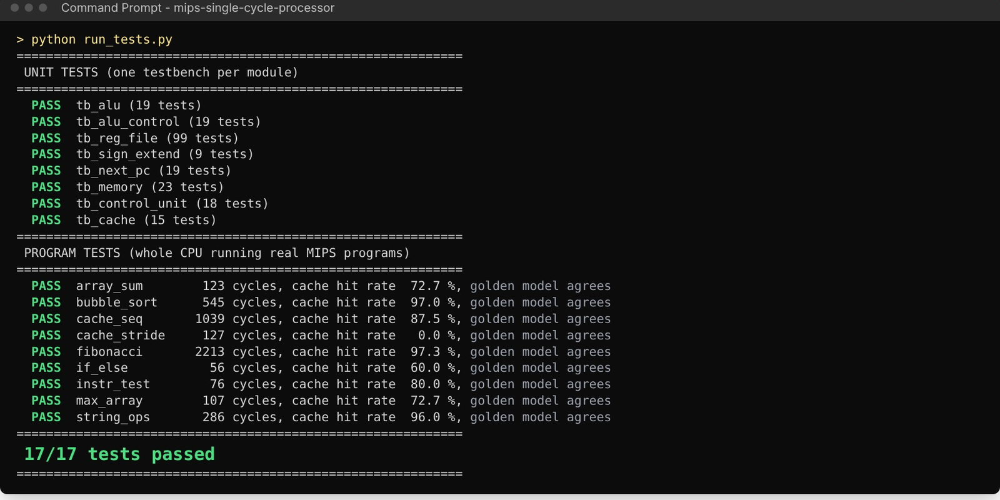
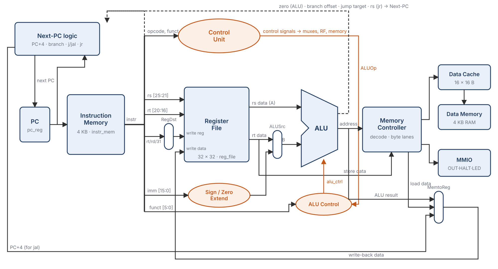
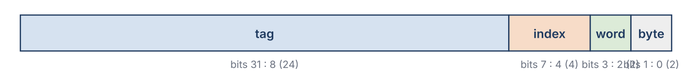
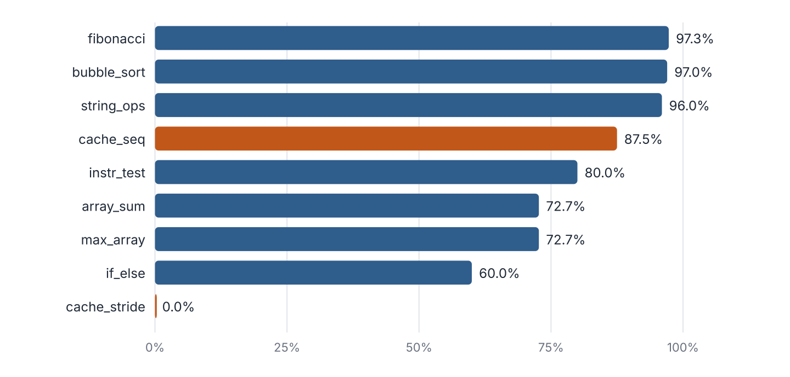
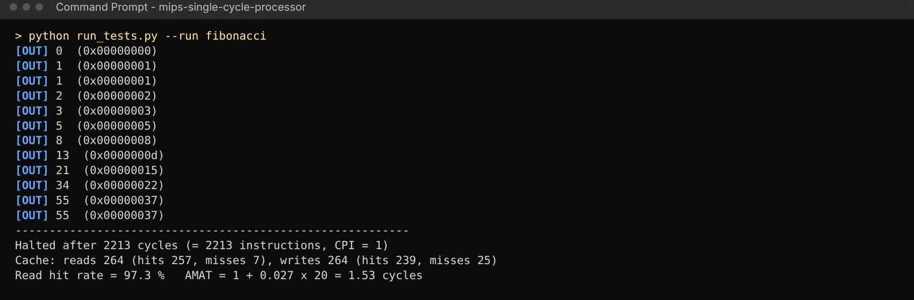
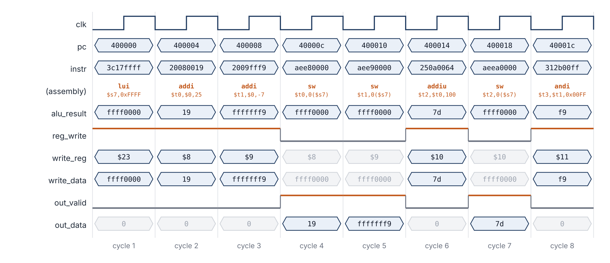

# Single-Cycle MIPS Processor with Memory Interface

**Modern Computer Architecture (MCA) · Team Vaibhav Ke Veer · Group B**

A 32-bit MIPS processor written in Verilog. Every instruction finishes in **one clock cycle**. The processor is connected to a full **memory interface** (address decoder, byte loads/stores, memory-mapped I/O) and a direct-mapped **data cache** that measures hit rate and AMAT. It runs 9 real MIPS programs and passes **all 17 tests**.

▶ **Demo video:** [Watch the demo (3 min)](VIDEO_LINK_HERE) &nbsp;·&nbsp; 📄 **Report:** [Project_Report.pdf](docs/Project_Report.pdf) &nbsp;·&nbsp; 📊 **Slides:** [presentation](presentation/MIPS_Processor_Presentation.pdf)



---

## Team

| Member | GitHub | Contribution |
|---|---|---|
| Kunal Dev Sahu (2401010244) | [@kunaldevsahu](https://github.com/kunaldevsahu) | Main control unit `control_unit.v`, data cache `cache.v`, CPU integration `mips_cpu.v` / `mips_top.v`, system testbench, assembler, Python golden model, test runner, docs |
| Vaibhav Singh (2401020074) | [@VaibhavSingh50](https://github.com/VaibhavSingh50) | ALU `alu.v` and ALU control `alu_control.v`, with testbenches |
| Himanshu Pal (2401010190) | [@HimanshuPal29](https://github.com/HimanshuPal29) | Register file `reg_file.v` and sign extender `sign_extend.v`, with testbenches |
| Kevish Sewliya (2401010224) | [@kevish-dev](https://github.com/kevish-dev) | Memory interface: `instr_mem.v`, `data_mem.v`, `mem_controller.v`, memory-mapped I/O `mmio.v`, with testbench |
| Pranav Singh (2401010333) | [@Pranav-Singh-Devloper](https://github.com/Pranav-Singh-Devloper) | Program counter `pc_reg.v`, next-PC logic `next_pc.v`, multiplexers `mux.v`, the 9 MIPS test programs |

Each member's part is explained in [docs/modules/](docs/modules), and [docs/TEAM.md](docs/TEAM.md) lists every file and who built it.

---

## How the processor works (in one minute)

Every instruction goes through five steps, **all in the same clock cycle**:

| Step | What happens | Hardware |
|---|---|---|
| **IF** fetch | The PC addresses the instruction memory | `pc_reg`, `instr_mem` |
| **ID** decode | Control signals are set, two registers are read, the 16-bit constant is extended | `control_unit`, `reg_file`, `sign_extend` |
| **EX** execute | The ALU computes a result, an address, or a branch comparison | `alu_control`, `alu` |
| **MEM** memory | Loads/stores go through the memory controller to the cache/RAM or I/O | `mem_controller`, `cache`, `data_mem`, `mmio` |
| **WB** write back | The result is written to a register and the PC moves on (rising clock edge) | `reg_file`, `next_pc` |

So **CPI = 1**: the number of clock cycles always equals the number of instructions. Instructions and data sit in separate memories (Harvard architecture), so the fetch and a load can happen in the same cycle.

### Datapath



### Instruction set (29 instructions)

| Type | Instructions |
|---|---|
| R-type | `add addu sub subu and or xor nor slt sll srl sra jr` |
| I-type | `addi addiu slti andi ori xori lui lw lb lbu sw sb beq bne` |
| J-type | `j jal` |

Full encodings and the control-signal table are in [docs/ARCHITECTURE.md](docs/ARCHITECTURE.md).

### Memory map

| Address | Device |
|---|---|
| `0x0040_0000` | Instruction memory, 4 KB (program starts here, same as MARS) |
| `0x1001_0000` | Data RAM, 4 KB, through the cache |
| `0xFFFF_0000` | **OUT**: a program prints a value by storing it here |
| `0xFFFF_0004` | **HALT**: storing here stops the processor |
| `0xFFFF_0008` / `000C` | LED register / cycle counter |

### Data cache

Direct-mapped, 16 lines × 16-byte blocks (256 B), write-through, no-write-allocate. The address is split like this:



A **hit** means the line is valid and its stored tag matches. On a read miss, the whole 4-word block is copied from RAM. The cache counts hits and misses, and the testbench reports **AMAT = 1 + miss rate × 20** cycles.

---

## Results

### Programs on the complete CPU

| Program | What it shows | Cycles (= instructions) | Cache hit rate | AMAT (cycles) |
|---|---|---|---|---|
| `instr_test` | every one of the 29 instructions | 76 | 80.0 % | 5.00 |
| `array_sum` | storing an array with `sw`, then summing it | 123 | 72.7 % | 6.45 |
| `max_array` | maximum and minimum of an array | 107 | 72.7 % | 6.45 |
| `if_else` | if / else, absolute value | 56 | 60.0 % | 9.00 |
| `fibonacci` | `jal` / `jr`, recursion with a stack | 2213 | 97.3 % | 1.53 |
| `bubble_sort` | nested loops, swaps in memory | 545 | 97.0 % | 1.60 |
| `string_ops` | byte access: `lb`, `lbu`, `sb` | 286 | 96.0 % | 1.80 |
| `cache_seq` | sequential reads (spatial + temporal locality) | 1039 | 87.5 % | 3.50 |
| `cache_stride` | 256-byte stride (conflict misses) | 127 | 0.0 % | 21.00 |

Every program's output is checked three ways: **hand-calculated answers = Python golden model = Verilog hardware**. The 8 module testbenches add **221 more checks**, and all of them pass.



Same kind of loads, **6× slower** average memory access when a program has no locality (`cache_seq` 3.5 cycles vs `cache_stride` 21 cycles).

### Example run: recursive Fibonacci



### Simulation waveform

The first 8 cycles of `instr_test`: the PC moves by 4 every clock (one instruction per cycle), and each store to the OUT port pulses `out_valid` with the value just computed.



---

## Repository structure

| Folder / file | Contents |
|---|---|
| `rtl/` | Verilog design: `defines.vh`, `alu.v`, `alu_control.v`, `reg_file.v`, `sign_extend.v`, `pc_reg.v`, `next_pc.v`, `mux.v`, `control_unit.v`, `instr_mem.v`, `data_mem.v`, `mem_controller.v`, `mmio.v`, `cache.v`, `mips_cpu.v`, `mips_top.v` |
| `tb/` | 8 module testbenches + `tb_mips_top.v` (runs a whole program, checks outputs, prints cache stats) |
| `programs/` | 9 MIPS test programs (`.asm`) and their expected outputs (`.expected`) |
| `tools/` | `assembler.py` (two-pass MIPS assembler), `iss.py` (Python golden model) |
| `run_tests.py`, `Makefile` | One command to build and run every test |
| `docs/` | Architecture, verification, team, one guide per member, figures, [PDF report](docs/Project_Report.pdf) |
| `presentation/` | Slides (`.pptx` and `.pdf`) with speaker notes |

---

## How to run

Install the free tools:

| OS | Command |
|---|---|
| macOS (Homebrew) | `brew install icarus-verilog surfer` |
| Ubuntu / WSL | `sudo apt install iverilog gtkwave python3` |
| Windows | Icarus Verilog from [bleyer.org/icarus](https://bleyer.org/icarus/) (tick "Add to PATH"; includes GTKWave) + Python 3 |

Run every test (prints PASS/FAIL, cycles and cache hit rate):
```bash
python3 run_tests.py
```

Run one program (prints its outputs, cache stats and final registers):
```bash
python3 run_tests.py --run fibonacci
```

Save a waveform and open it in Surfer or GTKWave:
```bash
python3 run_tests.py --run fibonacci --wave
surfer build/fibonacci.vcd        # or: gtkwave build/fibonacci.vcd
```

Write your own program: put a `.asm` file in `programs/`, print with `sw $reg, 0($s7)` (where `$s7 = 0xFFFF0000`) and stop with `sw $zero, 4($s7)`:
```bash
python3 tools/iss.py programs/myprog.asm      # what it should print
python3 run_tests.py --run myprog             # run it on the hardware
```

On Windows, use `python` instead of `python3`.
