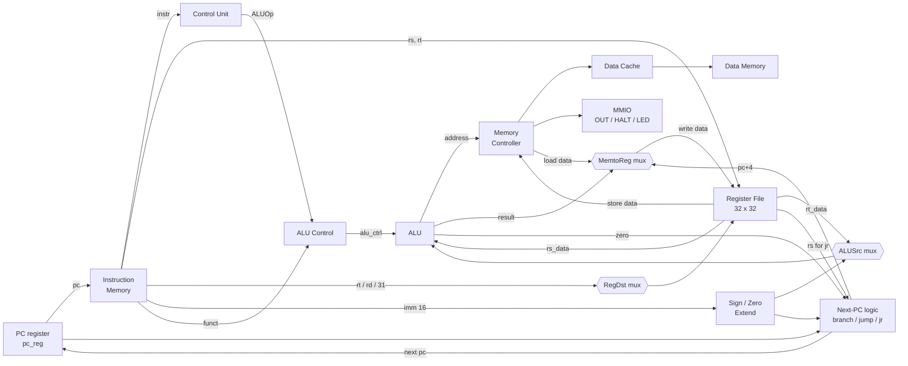

# Architecture

Author: Kunal Dev Sahu, with module sections reviewed by each owner.

## 1. Overview

The processor is a **single-cycle MIPS32 subset**. In each clock cycle one instruction goes through all five stages:

| Stage | What happens | Hardware |
|---|---|---|
| **IF** Fetch | PC addresses instruction memory | `pc_reg`, `instr_mem` |
| **ID** Decode | Fields split, control signals generated, registers read, immediate extended | `control_unit`, `reg_file`, `sign_extend` |
| **EX** Execute | ALU computes a result, an address or a branch comparison | `alu_control`, `alu` |
| **MEM** Memory | Load/store through the memory interface | `mem_controller`, `cache`, `data_mem`, `mmio` |
| **WB** Write back | Result written to the register file; PC updated | `reg_file`, `next_pc` |

Everything except the register file, PC, data memory, cache and I/O registers is **combinational**. State changes only on the rising clock edge, so **CPI = 1** and the clock period must cover the slowest instruction (`lw`: IF → register read → ALU → memory → write-back).

It uses a **Harvard architecture**: separate instruction and data memories, so fetch and data access never compete.

## 2. Datapath



### Multiplexers

| Mux | Select | 0 | 1 | 2 |
|---|---|---|---|---|
| RegDst | `reg_dst` | rt (I-type) | rd (R-type) | 31 (`jal`) |
| ALUSrc | `alu_src` | rt_data | extended immediate | — |
| MemtoReg | `mem_to_reg` | ALU result | memory data | PC+4 (`jal`) |
| PCSrc (in `next_pc`) | priority | `jr` → rs | `j`/`jal` → jump target | branch taken → PC+4+offset·4, else PC+4 |

## 3. Instruction set

### Formats

```
R-type:  | opcode(6) | rs(5) | rt(5) | rd(5) | shamt(5) | funct(6) |
I-type:  | opcode(6) | rs(5) | rt(5) |        immediate(16)        |
J-type:  | opcode(6) |              target(26)                     |
```

### Supported instructions (29)

| Instruction | Type | Opcode | Funct | Operation |
|---|---|---|---|---|
| `add rd, rs, rt` | R | 0x00 | 0x20 | rd = rs + rt |
| `addu rd, rs, rt` | R | 0x00 | 0x21 | rd = rs + rt |
| `sub rd, rs, rt` | R | 0x00 | 0x22 | rd = rs − rt |
| `subu rd, rs, rt` | R | 0x00 | 0x23 | rd = rs − rt |
| `and rd, rs, rt` | R | 0x00 | 0x24 | rd = rs & rt |
| `or rd, rs, rt` | R | 0x00 | 0x25 | rd = rs \| rt |
| `xor rd, rs, rt` | R | 0x00 | 0x26 | rd = rs ^ rt |
| `nor rd, rs, rt` | R | 0x00 | 0x27 | rd = ~(rs \| rt) |
| `slt rd, rs, rt` | R | 0x00 | 0x2A | rd = (rs < rt) signed |
| `sll rd, rt, sh` | R | 0x00 | 0x00 | rd = rt << sh |
| `srl rd, rt, sh` | R | 0x00 | 0x02 | rd = rt >> sh (logical) |
| `sra rd, rt, sh` | R | 0x00 | 0x03 | rd = rt >> sh (arithmetic) |
| `jr rs` | R | 0x00 | 0x08 | PC = rs |
| `addi rt, rs, imm` | I | 0x08 | — | rt = rs + sext(imm) |
| `addiu rt, rs, imm` | I | 0x09 | — | rt = rs + sext(imm) |
| `slti rt, rs, imm` | I | 0x0A | — | rt = (rs < sext(imm)) |
| `andi rt, rs, imm` | I | 0x0C | — | rt = rs & zext(imm) |
| `ori rt, rs, imm` | I | 0x0D | — | rt = rs \| zext(imm) |
| `xori rt, rs, imm` | I | 0x0E | — | rt = rs ^ zext(imm) |
| `lui rt, imm` | I | 0x0F | — | rt = imm << 16 |
| `lb rt, off(rs)` | I | 0x20 | — | rt = sext(MEM8[rs+off]) |
| `lw rt, off(rs)` | I | 0x23 | — | rt = MEM32[rs+off] |
| `lbu rt, off(rs)` | I | 0x24 | — | rt = zext(MEM8[rs+off]) |
| `sb rt, off(rs)` | I | 0x28 | — | MEM8[rs+off] = rt[7:0] |
| `sw rt, off(rs)` | I | 0x2B | — | MEM32[rs+off] = rt |
| `beq rs, rt, label` | I | 0x04 | — | if (rs == rt) PC = PC+4 + off·4 |
| `bne rs, rt, label` | I | 0x05 | — | if (rs ≠ rt) PC = PC+4 + off·4 |
| `j label` | J | 0x02 | — | PC = {PC+4[31:28], target, 00} |
| `jal label` | J | 0x03 | — | $ra = PC+4; PC = jump target |

Pseudo-instructions handled by the assembler: `li`, `la`, `move`, `nop`, `b`, `beqz`, `bnez`, `blt`, `bgt`, `ble`, `bge`.

Overflow is detected by the ALU (`overflow` output) but does not raise an exception. A single-cycle design has no exception handling.

## 4. Control signals

Generated by `control_unit.v`. An `X` means the value doesn't matter.

| Instr | RegDst | ALUSrc | MemtoReg | RegWrite | MemRead | MemWrite | Byte | Unsigned | Branch | BranchNE | Jump | JumpReg | ExtOp | ALUOp |
|---|---|---|---|---|---|---|---|---|---|---|---|---|---|---|
| R-type | 01 (rd) | 0 | 00 | 1 | 0 | 0 | 0 | 0 | 0 | 0 | 0 | 0 | X | 010 (funct) |
| jr | X | X | X | 0 | 0 | 0 | 0 | 0 | 0 | 0 | 0 | **1** | X | X |
| addi/addiu | 00 (rt) | 1 | 00 | 1 | 0 | 0 | 0 | 0 | 0 | 0 | 0 | 0 | 1 | 000 (add) |
| slti | 00 | 1 | 00 | 1 | 0 | 0 | 0 | 0 | 0 | 0 | 0 | 0 | 1 | 110 (slt) |
| andi | 00 | 1 | 00 | 1 | 0 | 0 | 0 | 0 | 0 | 0 | 0 | 0 | **0** | 011 (and) |
| ori | 00 | 1 | 00 | 1 | 0 | 0 | 0 | 0 | 0 | 0 | 0 | 0 | **0** | 100 (or) |
| xori | 00 | 1 | 00 | 1 | 0 | 0 | 0 | 0 | 0 | 0 | 0 | 0 | **0** | 101 (xor) |
| lui | 00 | 1 | 00 | 1 | 0 | 0 | 0 | 0 | 0 | 0 | 0 | 0 | X | 111 (lui) |
| lw | 00 | 1 | 01 (mem) | 1 | 1 | 0 | 0 | 0 | 0 | 0 | 0 | 0 | 1 | 000 |
| lb | 00 | 1 | 01 | 1 | 1 | 0 | **1** | 0 | 0 | 0 | 0 | 0 | 1 | 000 |
| lbu | 00 | 1 | 01 | 1 | 1 | 0 | **1** | **1** | 0 | 0 | 0 | 0 | 1 | 000 |
| sw | X | 1 | X | 0 | 0 | 1 | 0 | 0 | 0 | 0 | 0 | 0 | 1 | 000 |
| sb | X | 1 | X | 0 | 0 | 1 | **1** | 0 | 0 | 0 | 0 | 0 | 1 | 000 |
| beq | X | 0 | X | 0 | 0 | 0 | 0 | 0 | **1** | 0 | 0 | 0 | 1 | 001 (sub) |
| bne | X | 0 | X | 0 | 0 | 0 | 0 | 0 | 0 | **1** | 0 | 0 | 1 | 001 (sub) |
| j | X | X | X | 0 | 0 | 0 | 0 | 0 | 0 | 0 | **1** | 0 | X | X |
| jal | 10 ($ra) | X | 10 (PC+4) | 1 | 0 | 0 | 0 | 0 | 0 | 0 | **1** | 0 | X | X |

### Two-level ALU decoding

The main control produces a 3-bit **ALUOp**. The ALU control (`alu_control.v`) turns that into a 4-bit **ALU control code**. For R-type instructions it uses the `funct` field to decide.

| ALU code | Operation | Used by |
|---|---|---|
| 0000 | AND | and, andi |
| 0001 | OR | or, ori |
| 0010 | ADD | add(u), addi(u), loads, stores |
| 0011 | XOR | xor, xori |
| 0100 | NOR | nor |
| 0110 | SUB | sub(u), beq, bne |
| 0111 | SLT | slt, slti |
| 1000 | SLL | sll |
| 1001 | SRL | srl |
| 1010 | SRA | sra |
| 1011 | LUI | lui |

## 5. Memory map

| Address range | Size | Device | Access |
|---|---|---|---|
| `0x0040_0000` – `0x0040_0FFF` | 4 KB | Instruction memory (`instr_mem`) | fetch only |
| `0x1001_0000` – `0x1001_0FFF` | 4 KB | Data RAM (`data_mem`) via `cache` | lw/sw/lb/lbu/sb |
| `0xFFFF_0000` | 4 B | **OUT**: write prints a value; read returns the last one | R/W |
| `0xFFFF_0004` | 4 B | **HALT**: any write stops the processor | W |
| `0xFFFF_0008` | 4 B | **LED**: 8-bit output register (for an FPGA board) | R/W |
| `0xFFFF_000C` | 4 B | **CYCLE**: clock cycles since reset | R |
| anything else | — | unmapped, raises `mem_error` | — |

The text and data base addresses are the same as the **MARS** simulator, so programs can be checked in MARS too.

Memory is **little-endian**: byte 0 of a word is bits 7:0.

## 6. Memory interface

```
 CPU ── addr, wdata, re, we, byte, unsigned ──► mem_controller
                                                  │  decode addr[31:12] == 0x10010 → RAM
                                                  │         addr[31:16] == 0xFFFF  → I/O
                                                  │  stores: byte-enable = 0001 << addr[1:0],
                                                  │          data copied to all 4 byte lanes
                                                  │  loads : pick byte (addr[1:0]),
                                                  │          sign-extend (lb) / zero-extend (lbu)
                                                  │  errors: misaligned word, unmapped address
                       ┌──────────────────────────┴──────────┐
                     cache ──► data_mem (byte enables)     mmio (OUT, HALT, LED, CYCLE)
```

## 7. Data cache

| Parameter | Value |
|---|---|
| Organisation | Direct-mapped |
| Lines | 16 |
| Block size | 4 words (16 bytes) |
| Capacity | 256 bytes of data |
| Address split | tag = addr[31:8], index = addr[7:4], word offset = addr[3:2], byte = addr[1:0] |
| Read miss | Allocate: the whole block is copied from RAM (uses spatial locality) |
| Write policy | Write-through (RAM is always up to date) |
| Write miss | No-write-allocate |
| Statistics | read hits/misses, write hits/misses |

In a single-cycle CPU the RAM answers in the same cycle, so the cache does not change timing. Instead it **measures locality**: the testbench reads its counters at the end and computes

```
AMAT = Hit time + Miss rate × Miss penalty      (Hit time = 1 cycle, Miss penalty = 20 cycles)
```

The demo programs `cache_seq.asm` (87.5 % hits) and `cache_stride.asm` (0 % hits) show the difference between good spatial/temporal locality and conflict misses.

## 8. Timing (critical path)

The slowest instruction is `lw`:

```
PC clk→q → instruction memory → register file read → ALU (address add)
         → memory controller → cache/RAM read → byte select → MemtoReg mux → register setup
```

The clock period must be longer than this path. That is the main drawback of a single-cycle design: even a simple `add` has to wait one full `lw`-length cycle. Pipelining fixes this (see [REPORT.md](REPORT.md#future-work)).
